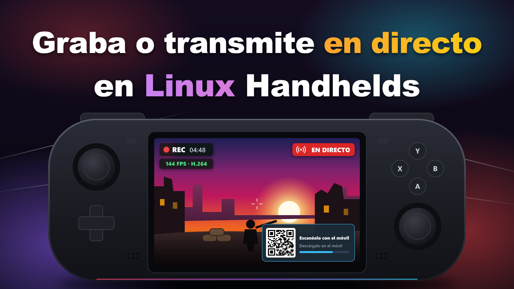
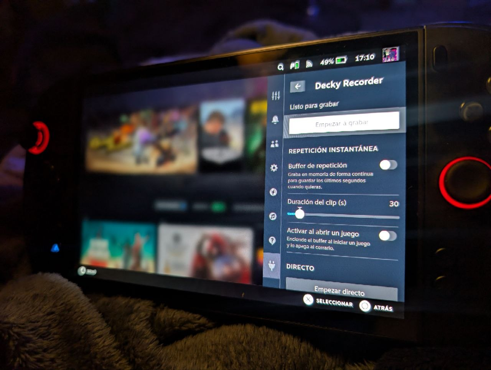
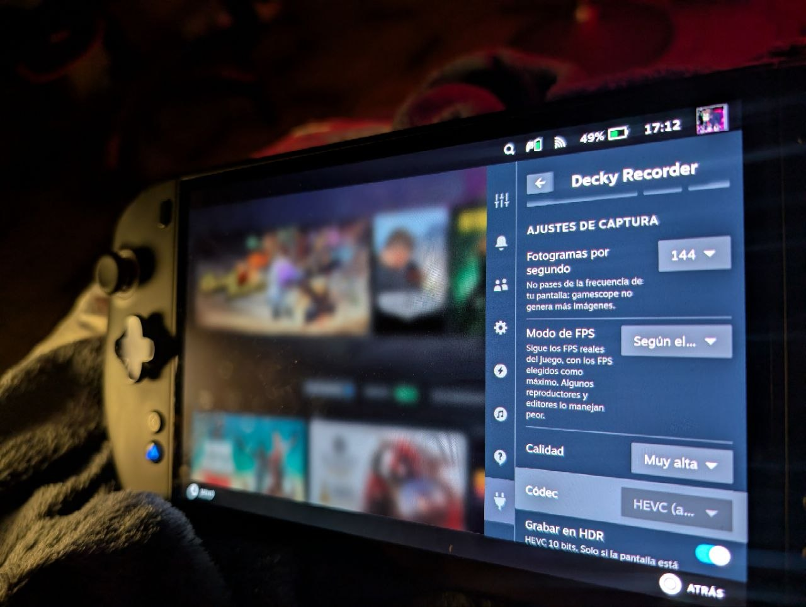
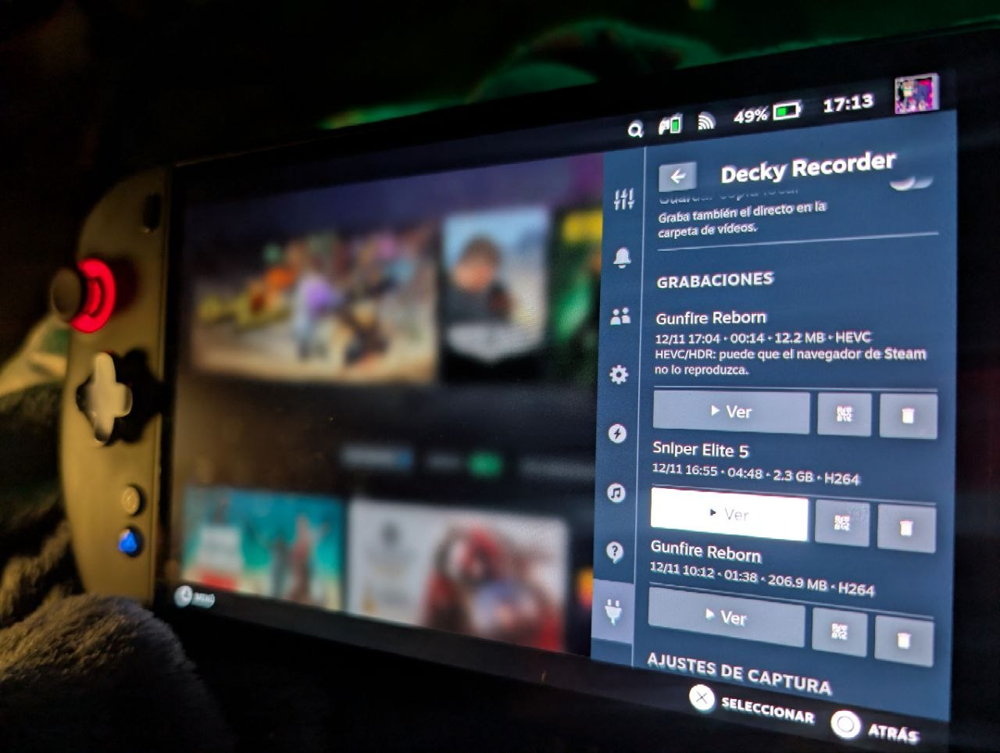
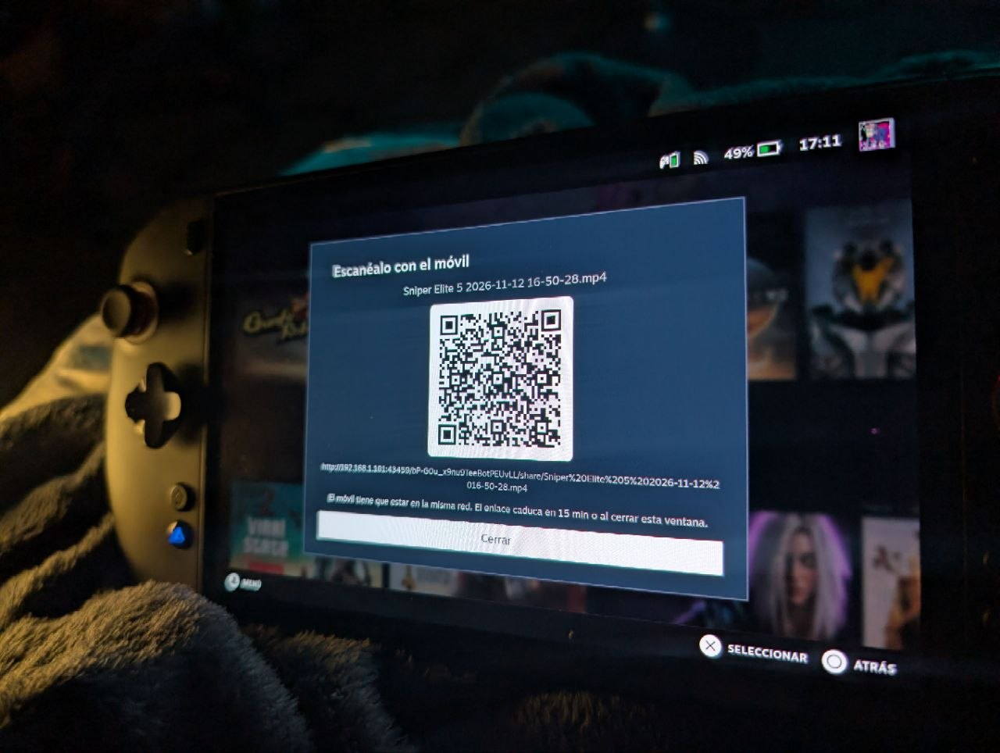
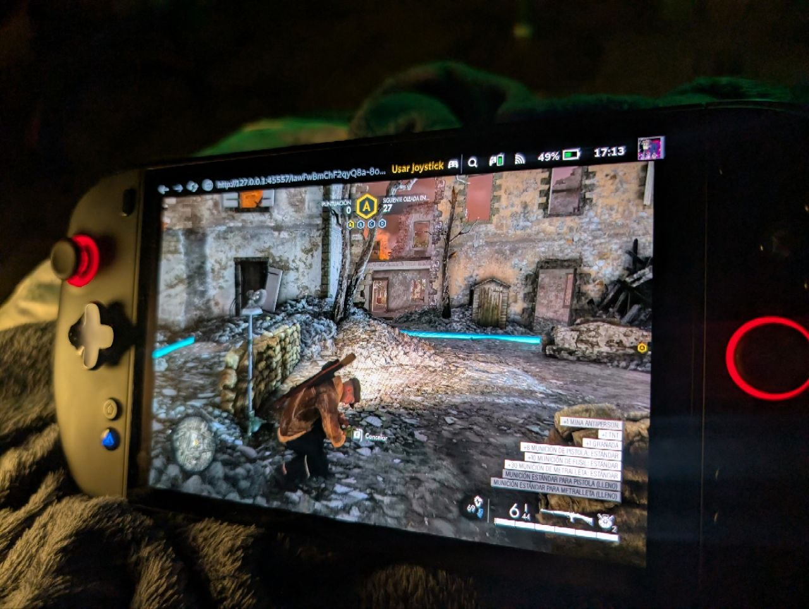

# Decky Recorder

**Graba, guarda clips y transmite en directo desde el modo juego de tu portátil Linux, sin tirones.**

[English](README.md) · Español

Plugin para [Decky Loader](https://github.com/SteamDeckHomebrew/decky-loader) basado en
[GPU Screen Recorder](https://git.dec05eba.com/gpu-screen-recorder/about/).

## Funciones

- **Vídeo fluido.** 30, 60, 72, 90, 100, 120 o 144 fps constantes, así el vídeo no da tirones aunque
  los FPS del juego varíen. O, si lo prefieres, siguiendo los FPS reales del juego (variable).
- **Ligero.** Captura KMS de la imagen que compone gamescope, codificada en la GPU (VA-API).
- **Repetición instantánea.** Guarda en memoria los últimos 5–300 segundos y conviértelos en un clip.
  Puede activarse sola al abrir un juego.
- **Directo** en Twitch, YouTube Live o tu propio servidor RTMP/SRT, con copia local opcional.
  La clave de emisión se guarda solo en la consola y nunca se escribe en los registros.
- **Galería de grabaciones.** Ve tus vídeos en el navegador de Steam sin salir del modo juego, o bórralos.
- **Compartir con QR.** Escanéalo con el móvil (misma red) para ver o descargar una grabación.
  El enlace es temporal y solo sirve para ese vídeo.
- **Acceso desde el PC.** Actívalo, abre la dirección corta en el navegador del PC, escribe el PIN y
  descarga cualquier grabación. Se apaga solo a los 30 minutos.
- H.264 o HEVC, HDR opcional (HEVC 10 bits), audio del juego y micrófono.
- Los vídeos se guardan en `~/Videos/Decky Recorder`.
- Interfaz en español e inglés.

## Capturas

<table>
  <tr>
    <td></td>
    <td></td>
  </tr>
  <tr>
    <td></td>
    <td></td>
  </tr>
  <tr>
    <td colspan="2" align="center"></td>
  </tr>
</table>

## Instalación

1. Descarga `decky-recorder-vX.Y.Z.zip` de la
   [última versión](https://github.com/Pochowan/decky-recorder/releases/latest).
2. En Decky, abre **Ajustes → Desarrollador → Instalar plugin desde ZIP** y elige el archivo.

## Consejos

- **Reproducir en Steam:** el navegador de Steam reproduce H.264. Las grabaciones en HEVC o HDR pueden
  no reproducirse ahí; ábrelas en el modo escritorio o pásalas al móvil con el QR.
- **Clave de emisión:** escribirla con el teclado en pantalla es pesado. En el modo escritorio, pégala en
  `~/stream_key.txt`, usa **Importar de ~/stream_key.txt** y borra el archivo después.
- **Ancho de banda del directo:** Twitch acepta hasta 6000 kbps. Tu velocidad de subida tiene que superar
  con margen el bitrate que elijas.
- **Juegos HDR:** si la grabación de un juego HDR sale rojiza u oscura, activa **Corregir colores en
  juegos HDR** en los ajustes de captura. Solo actúa mientras capturas y consume algo más de batería.

## Cómo funciona

El ZIP incluye la AppImage de GPU Screen Recorder, que el plugin extrae la primera vez que carga.
El backend del plugin corre como root (flag `root` de Decky) y lanza GPU Screen Recorder como tu usuario
con solo la capacidad `CAP_SYS_ADMIN` (mediante `setpriv`), que hereda su ayudante de captura KMS, así
que no pide contraseña. El plugin lo arranca, lo para y se comunica con él mediante señales.

## Licencia

MIT. GPU Screen Recorder es GPL-3.0; consulta [THIRD_PARTY_NOTICES.md](THIRD_PARTY_NOTICES.md).
