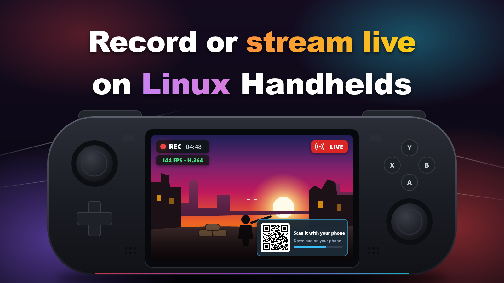
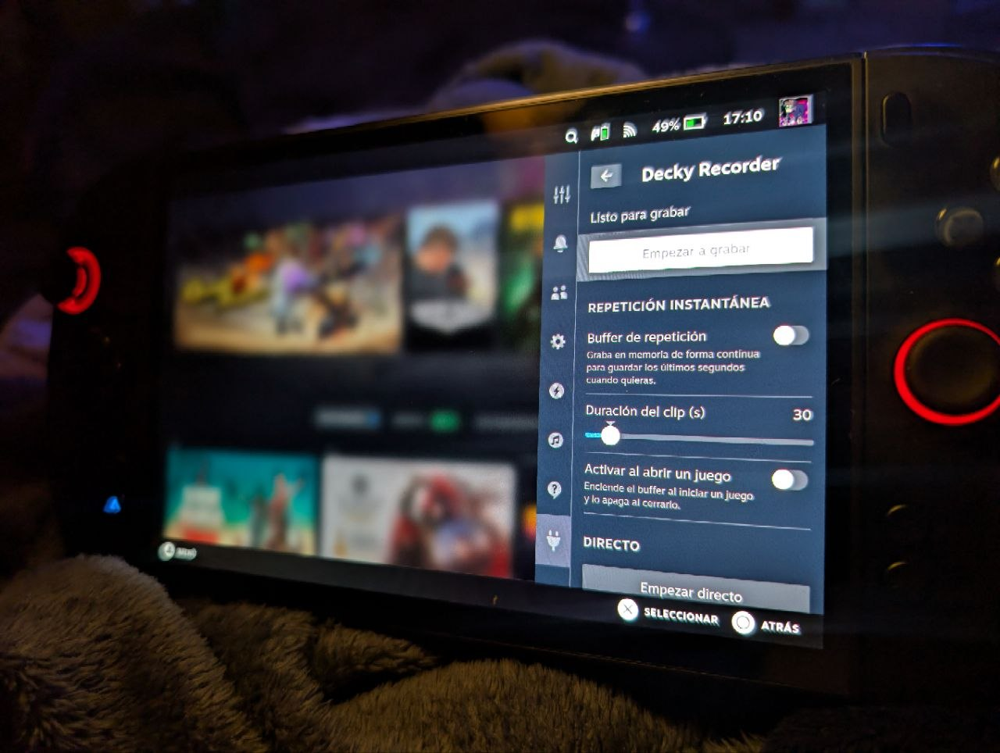
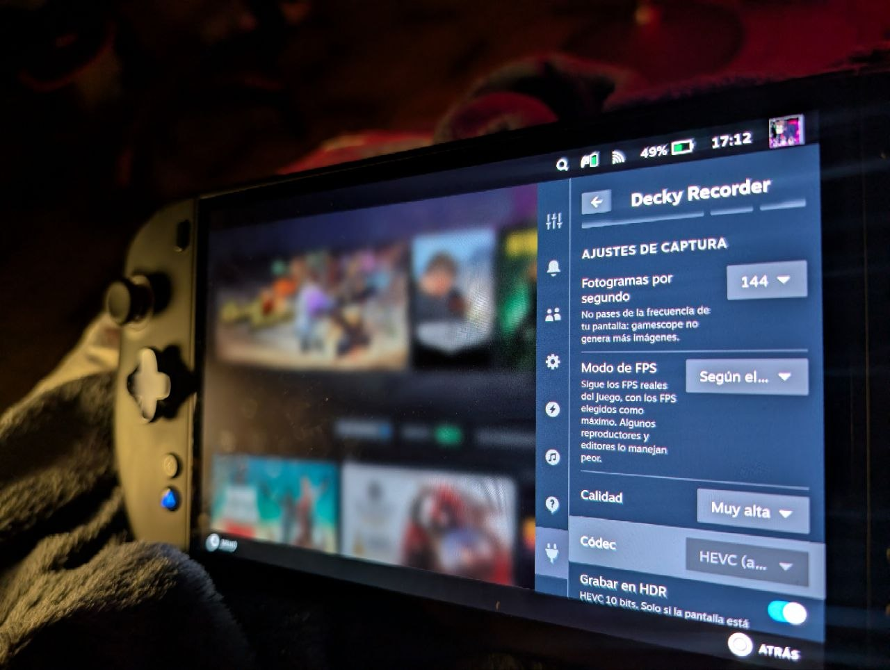
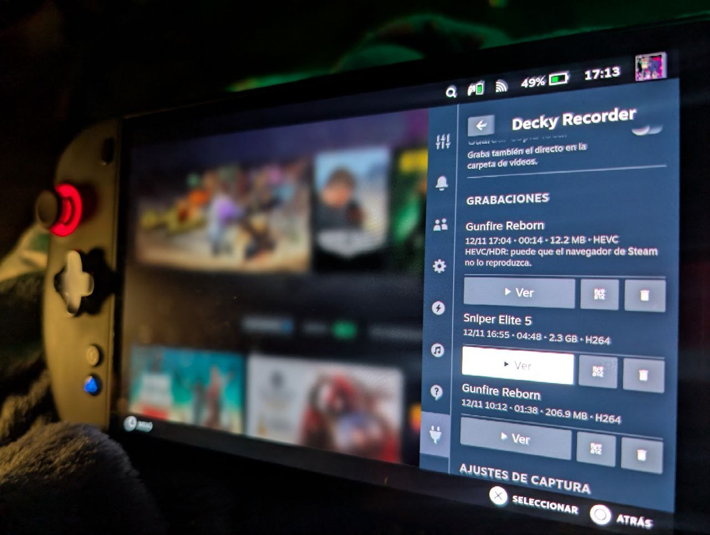
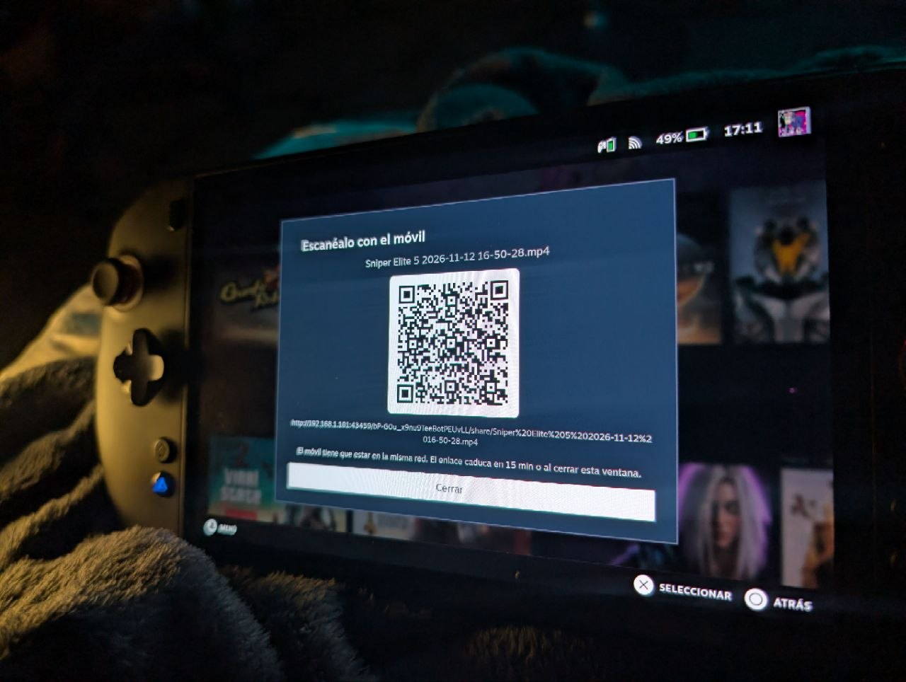
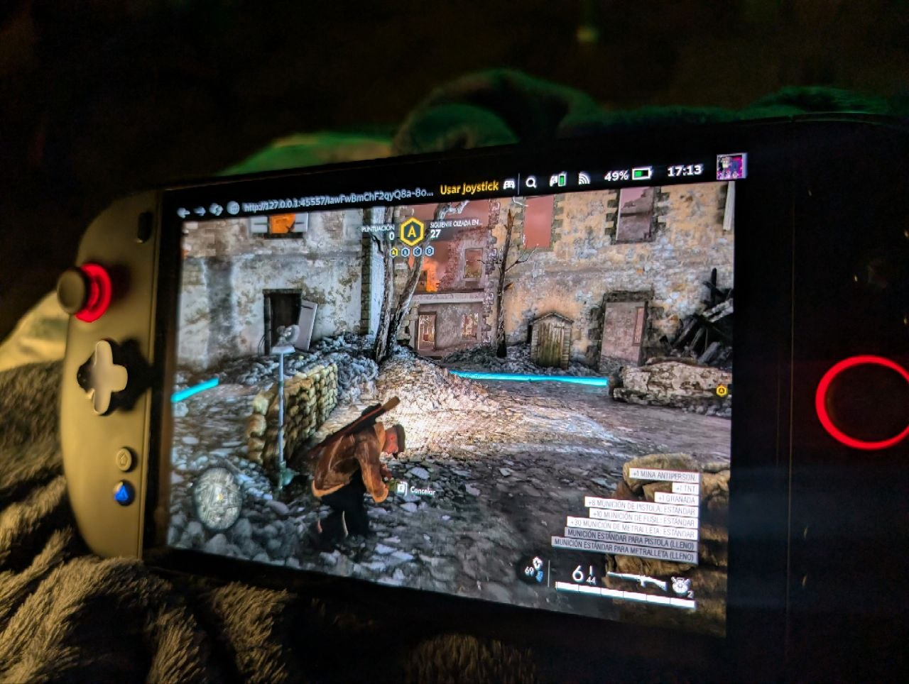

# Decky Recorder

**Record, clip and stream live from Game Mode on Linux handhelds, without stutter.**

English · [Español](README.es.md)

A [Decky Loader](https://github.com/SteamDeckHomebrew/decky-loader) plugin powered by
[GPU Screen Recorder](https://git.dec05eba.com/gpu-screen-recorder/about/).

## Features

- **Smooth video.** 30, 60, 72, 90, 100, 120 or 144 fps at a constant frame rate, so the video
  doesn't stutter when the game's frame rate varies. Or match the game's real frame rate (variable).
- **Light on performance.** KMS capture of the image composed by gamescope, encoded on the GPU (VA-API).
- **Instant replay.** Keep the last 5–300 seconds in memory and save them as a clip. It can turn on
  by itself when a game starts.
- **Live streaming** to Twitch, YouTube Live or your own RTMP/SRT server, with an optional local copy.
  The stream key is stored only on the console and is never written to the logs.
- **Recordings gallery.** Play your videos in Steam's browser without leaving Game Mode, or delete them.
- **Share with a QR code.** Scan it with your phone (same network) to watch or download a recording.
  The link is temporary and only works for that video.
- **PC access.** Turn it on and open the short address in your PC's browser, enter the PIN and
  download any recording. It turns itself off after 30 minutes.
- H.264 or HEVC, optional HDR (HEVC 10-bit), game audio and microphone.
- Videos are saved in `~/Videos/Decky Recorder`.
- Interface in English and Spanish.

## Screenshots

<table>
  <tr>
    <td></td>
    <td></td>
  </tr>
  <tr>
    <td></td>
    <td></td>
  </tr>
  <tr>
    <td colspan="2" align="center"></td>
  </tr>
</table>

## Install

1. Download `decky-recorder-vX.Y.Z.zip` from the
   [latest release](https://github.com/Pochowan/decky-recorder/releases/latest).
2. In Decky, open **Settings → Developer → Install plugin from ZIP** and pick the file.

## Tips

- **Playback in Steam:** Steam's browser plays H.264. HEVC and HDR recordings may not play there;
  open them in Desktop Mode or share them to your phone.
- **Stream key:** typing it with the on-screen keyboard is tedious. In Desktop Mode, paste it into
  `~/stream_key.txt`, use **Import from ~/stream_key.txt** and delete the file afterwards.
- **Streaming bandwidth:** Twitch accepts up to 6000 kbps. Your upload speed needs to be comfortably
  higher than the bitrate you choose.

## How it works

The ZIP bundles the GPU Screen Recorder AppImage, which the plugin extracts on first load. The
plugin's backend runs as root (Decky's `root` flag) and starts GPU Screen Recorder as your user with
only the `CAP_SYS_ADMIN` capability (via `setpriv`), which its KMS capture helper inherits, so there
is no password prompt. The plugin starts and stops it and talks to it through signals.

## License

MIT. GPU Screen Recorder is GPL-3.0; see [THIRD_PARTY_NOTICES.md](THIRD_PARTY_NOTICES.md).
